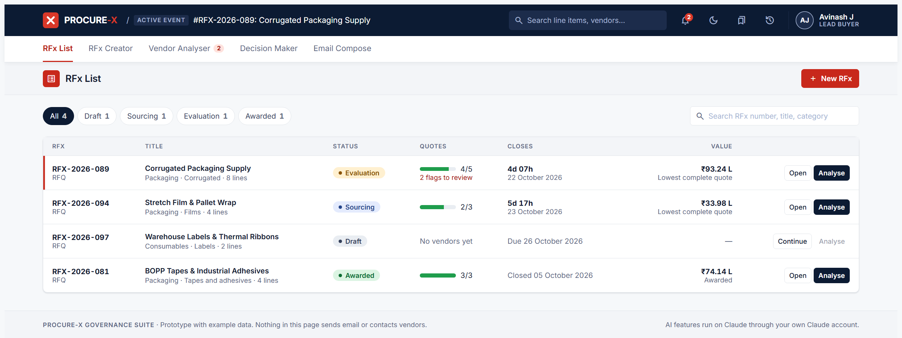
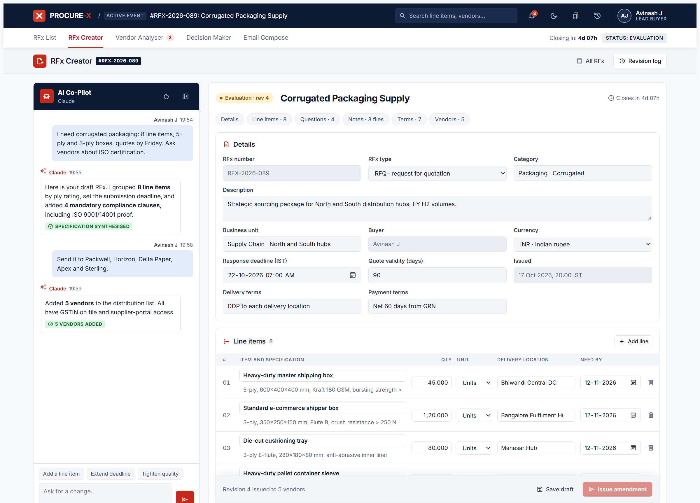
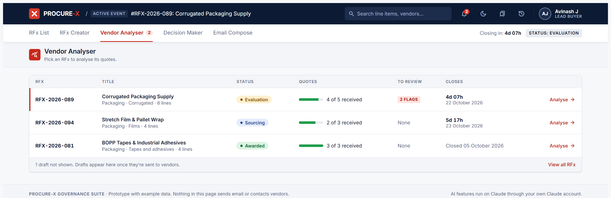
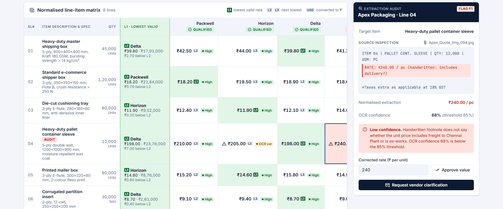
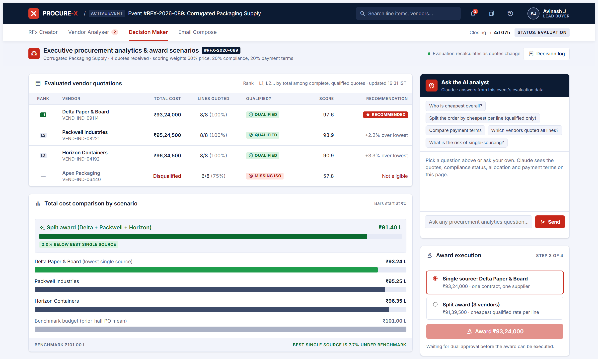
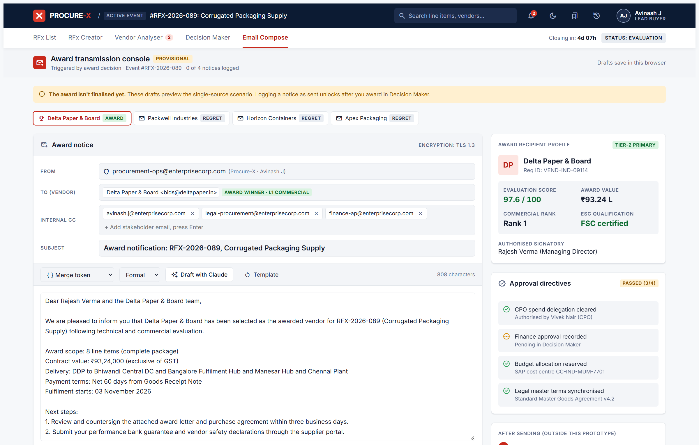

# Procure-X RFx Manager

**From RFx request to award, in one workspace.** AI does the reading and writing; the buyer makes every decision.

Procure-X is a working prototype of an AI-assisted sourcing tool. A buyer describes what they need in plain English and gets a complete RFx, uploads vendor quotes in any format, compares them in one normalised matrix, picks an award scenario and sends award and regret letters, all in one place.

| | |
|---|---|
| **Live app** | https://claude.ai/artifact/8a3cCrzvNdf1kp9pRYuKUQ |
| **Pitch deck** | https://claude.ai/artifact/9D74KSd867zeMb6TjfnDym |
| **Architecture** | https://claude.ai/artifact/VPX1bUKNaVR8zdPCc7cidb |
| **Walkthrough video** | [Add your Loom or Google Drive link] |

> The AI features run on Claude inside claude.ai. Open the live link while signed in to claude.ai and allow Claude when asked. Everything else works in any browser.



---

## The problem

Every sourcing event goes through the same four steps, and each one is manual today:

1. **Write the spec:** drafted by hand or copied from an old RFx.
2. **Read the quotes:** PDFs, Excel sheets and phone photos retyped line by line.
3. **Compare:** spreadsheet matrices that break on currency and unit mismatches.
4. **Approve and notify:** approvals chased over email; letters written from scratch.

## What it does

Five tabs follow the buyer's day: a home list, then the four steps.

| Tab | What AI does | What the buyer does |
|---|---|---|
| **RFx List** | | Sees every RFx and its stage, filters and searches, starts a new RFx or opens one |
| **RFx Creator** | Fills the whole create page from a plain-English request: details, line items, supplier questions, notes and terms | Reviews and edits every field, then sends the RFx or issues an amendment |
| **Vendor Analyser** | Reads quotes from PDF, Excel, CSV, text, email or a photo; maps prices to RFx lines; converts USD, EUR or GBP to ₹; flags anything uncertain | Picks which RFx to analyse, approves or corrects flagged prices, requests clarifications |
| **Decision Maker** | Answers questions about the bids from that RFx's own data | Picks single-source or split award; approvals gate large awards |
| **Email Compose** | Drafts an award or regret letter for every bidder, in a chosen tone | Edits, approves and sends |



| Vendor Analyser: pick an RFx | Vendor Analyser: matrix and audit |
|---|---|
|  |  |

| Decision Maker | Email Compose |
|---|---|
|  |  |

### The RFx create page

The right side of RFx Creator is a full create page, and the co-pilot on the left fills it as you describe what you need:

- **Details:** RFx number, type (RFQ, RFP or RFI), category, description, business unit, buyer, currency, response deadline, quote validity, delivery and payment terms.
- **Line items:** item, specification, quantity, unit, delivery location and need-by date.
- **Supplier questions:** with expected responses and a mandatory switch.
- **Notes and attachments:** instructions to suppliers and attached files.
- **Terms and conditions:** a standard set you can switch on or off, edit or extend.
- **Vendors:** chosen from the supplier directory or added new.

Sending checks the RFx is complete first: a title, every line with a name and quantity, at least one vendor and a future deadline.

## Design principles

- **AI drafts, people decide.** Every AI output is a draft the buyer can review, edit or reject. Nothing is sent or awarded without a person.
- **Maths in code, not in AI.** Totals, L1/L2/L3 ranks, scores and savings are calculated by the app. The AI explains the numbers but never produces them.
- **Every number is traceable.** Each extracted price keeps its source line, a confidence level and an audit-log entry.
- **Governance in the flow.** Awards above ₹25 L need CPO and Finance sign-off. Changes to an issued RFx reach the evaluation only when they're issued to vendors as a numbered amendment.

## How the evaluation works

- **Qualified vendor:** ISO 9001/14001 certified with a quote received.
- **L-ranks per line:** L1 is the lowest valid rate among qualified vendors; L2 and L3 are the next lowest. Low-confidence prices are excluded until a buyer approves them.
- **Score:** 60% price, 20% compliance, 20% payment terms (longer credit terms free working capital).
- **Recommendation:** the lowest total among complete, qualified quotes.
- **Split award:** the cheapest qualified, reviewed rate on each line, with the saving against the best single source.
- **Currency:** foreign-currency quotes are converted to ₹ at the rate the buyer sets for the day; extraction waits until today's rate is confirmed.
- **Amendments:** edits in RFx Creator stay a draft until issued. An issued line no qualified vendor has quoted yet is marked "awaiting quotes" and left out of the award, so it never blocks one.

## Product decisions and trade-offs

| In the prototype | Why | In production |
|---|---|---|
| The buyer sets the exchange rate each day | The prototype can't reach a live rate feed | Official daily reference rate, fetched automatically |
| Emails are logged, not sent | Keeps the demo safe; a person always sends | Email service plus e-signature |
| Example RFx and vendors | Shows every stage end to end | ERP and supplier-portal integration |
| Attachments listed by name only | No file storage in the prototype | Document storage with versioning |
| Doubtful prices excluded until approved | A wrong price costs more than a review | Confidence thresholds tuned on pilot data |

## Try it in five minutes

1. Open the **live app** on claude.ai, signed in. It opens on the **RFx List**.
2. Click **New RFx**, then the **Corrugated boxes** suggestion in the co-pilot. The create page fills in. Click **Send RFx**.
3. Go to **Vendor Analyser**, pick **RFX-…-089 Corrugated Packaging Supply**, and on the Sterling Corrugators card click **Add quote**. Upload [`test-quotes/Sterling_Corrugators_Quote_USD.png`](test-quotes/Sterling_Corrugators_Quote_USD.png), a quote priced in US dollars, confirm today's USD rate and click **Extract with Claude**. Prices should be converted to ₹, the freight footnote on line 4 flagged for review, and Sterling should become the lowest complete bid.
4. **Decision Maker:** ask the analyst "Should we split or single-source?", record the Finance approval, and execute the award.
5. **Email Compose:** draft the award and regret notices with Claude.

Use **Reset example data** (clock icon, top right) to start again.

## How it's built

The [architecture page](https://claude.ai/artifact/VPX1bUKNaVR8zdPCc7cidb) has the runtime diagram, the quote-to-award flow showing what Claude, the code and the buyer each do, the full tech stack, and how it was built. Its source is [`docs/architecture.html`](docs/architecture.html).

- **One self-contained HTML file** ([`procurex-rfx-manager.html`](procurex-rfx-manager.html)): plain HTML, CSS and JavaScript, no framework and no build step.
- **Hosting:** published as a [claude.ai artifact](https://claude.ai/artifact/8a3cCrzvNdf1kp9pRYuKUQ). Its runtime capabilities provide:
  - `sample`: calls to Claude for the co-pilot, quote extraction (including images), analyst and drafting, on the viewer's own Claude account.
  - `db` and `user`: saved views, private to each signed-in user.
  - `downloads`: CSV export of the comparison matrix.
- **File reading in the browser:** PDFs with [pdf.js](https://mozilla.github.io/pdf.js/) 3.11.174 (scanned PDFs are sent to Claude as page images); Excel with [SheetJS](https://sheetjs.com/) 0.18.5. Both load on demand from cdnjs.
- **Data:** the workspace (all RFx) is kept in the browser's local storage. Saved views go to the user's claude.ai account, or the browser when the page runs elsewhere.
- **Interface:** light and dark themes with a header switch; both AI panels can be minimised so the work area fills the page.
- **Design:** screens first designed in [Google Stitch](https://stitch.withgoogle.com/) (originals in [`stitch/`](stitch/)), then built and iterated with Claude Code. Type is Inter with JetBrains Mono; icons are Material Symbols.

### Run it locally

Open `procurex-rfx-manager.html` in any modern browser. Every screen, calculation, file reader and saved view works locally. The Claude-powered features only run when the page is opened from claude.ai.

## Known limitations

- AI features require claude.ai; each call uses the viewer's own Claude usage.
- Emails, purchase orders and e-signatures are simulated; nothing leaves the page.
- Attachments are listed by name; file contents aren't stored.
- Each viewer's data lives in their own browser, so viewers don't see each other's changes.
- Example data only: the RFx, vendors and prices are fictional.
- Uploads up to 25 MB; the first 15 pages of a PDF; up to 5 pages of a scanned PDF; the first 60,000 characters of text.

## Repository contents

```
procurex-rfx-manager.html    The app (single file)
stitch/                      Original Google Stitch screen designs (image + HTML)
test-quotes/                 Sample vendor quote (USD) for trying the upload
docs/architecture.html       Architecture diagrams and tech stack (source of the architecture page)
docs/screenshots/            Screens used in this README
```

## Next steps

A 6-week pilot on one sourcing category, measured on RFx-to-award cycle time, buyer hours per event, prices accepted without correction, savings against benchmark and adoption. After that: ERP integration, a supplier self-upload portal, e-signature and negotiation rounds.

---

Built by **Avinash J** as a product-management exercise.
